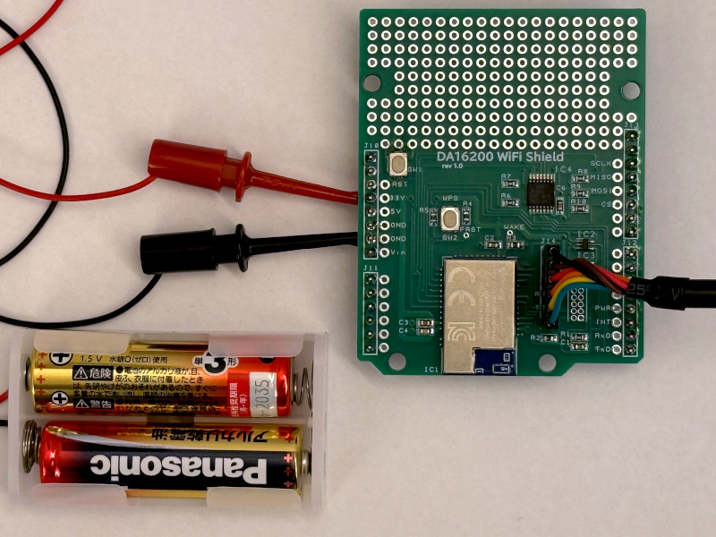
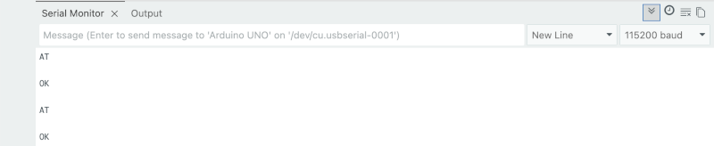

----------------------------------------
## 動作確認 : ボード単体で確認する場合

シリアルケーブルを使用し、ボード単体で動作確認する方法です。

### 用意するもの
* FTDI製USBシリアル変換ケーブル(3.3V) [TTL-232R-3V3](https://akizukidenshi.com/catalog/g/g105840/)（秋月電子で販売されています）
* 3.3V 直流電源（もしくは、電池2本直列でも動きます）
* その他 ICクリップなどの接続ケーブル

### 1. DA16200 UART0ポートによる確認

#### 接続 #####

1. USBシリアルケーブルをJ14に、接続します。GNDピン(▼) がJ14と書いてある側です。
2. PCでシリアルターミナルソフト(e.g. teraterm) を起動し、230400bpsにセットします。
3. J10のGNDおよび3.3Vピンに、電源を接続します。



#### 確認 ####

ターミナルソフトに DA16200 の起動メッセージが表示されます。
その後、エンターキーを押すごとに、`[/DA16200] # ` の表示がされることを確認します。

```
>>> UART1 : Clock=80000000, BaudRate=115200
>>> UART1 : DMA Enabled ...
RTC switched to XTAL

[/DA16200] #
[/DA16200] #
```

### 2. ATコマンドによる確認

モジュールの起動は確認できましたので、次にUARTで接続できるかの確認を行います。

#### 接続 #####

1. ボード右下の `TxD` と `RxD` ピンを、USBシリアルケーブルの `RxD` と `TxD` に接続します。
これは直接接続ができませんので、ICクリップやジャンパー線などを使用して接続します。
2. PCでシリアルターミナルソフトを起動し、115200bpsにセットします。
3. J10のGNDおよび3.3Vピンに、電源を接続します。

#### 確認 ####

1. ターミナルソフトから、ATと入力ます。
入力時には、画面には何も表示されないですが、それで正常です。
2. エンターを押すと、`OK` と表示されます。

以上で、UARTで接続ができ、ATコマンドを認識していることが確認できました。


----------------------------------------
## 動作確認 : Arduino UNO を使用する場合

以下の手順で確認します。

１．Arduino IDE を使って以下のプログラムを記述します。

```c++
void setup() {
  Serial.begin(115200);
}

void loop() {
  Serial.print("AT\r\n");
  String res = Serial.readString();
  Serial.println(res);

  // printした分エラーが返っているので、取り除く。
  while( res.length() != 0 ) {
    res = Serial.readString();
  }

  delay(4000);
}
```

２．まだ WiFiボードを Arduino に装着せずにプログラムを書き込みます。
３．一旦 USBケーブルを抜き、WiFiボードを Arduino へ装着します。
４．USBケーブルを接続し、IDEのシリアルモニタを 115200 baudに設定します。
５．以下のように `AT` および `OK` と数秒おきに表示されるのを確認します。




----------------------------------------
## 動作確認：RBoardを使用する場合

[RBoard](https://www.sjc-inc.co.jp/service/rboard) を使用して、動作確認する方法です。

１．WiFiボードを、RBoardへ装着します。
２．RBoardへ、以下のプログラムを書き込みます。
```ruby
#
# USB UART <-> Grove UART
#
uart1 = UART.new(1, baud:19200)      # USBUART
uart2 = UART.new(2, baud:115200)     # Grove UART pin.

flag_local_echo = false
sw2 = 1

while true
  n = uart1.bytes_available
  if n > 0
    leds_write(1)
    data = uart1.read( n )
    uart1.write( data ) if flag_local_echo
    uart2.write( data )
  end

  n = uart2.bytes_available
  if n > 0
    leds_write(2)
    data = uart2.read( n )
    uart1.write( data )
  end
  sleep_ms 5
  leds_write(0)

  # local echo on/off
  sw1 = sw()
  if sw1 != sw2 && sw1 == 0
    flag_local_echo = !flag_local_echo
    leds_write(3)
  end
  sw2 = sw1
end
```

３．PCでシリアルターミナルソフト(e.g. teraterm) を起動し、19299bpsにセットします。
４．ターミナルソフトから、ATと入力ます。
　　入力時には、画面には何も表示されないですが、それで正常です。
５．エンターを押すと、`OK` と表示されます。

以上で、UARTで接続ができ、ATコマンドを認識していることが確認できました。


----------------------------------------
## ATコマンド

利用しているWiFiモジュール DA16200 のマニュアルを参照します。
[ルネサスのウェブサイト](https://www.renesas.com/ja) で、`UM-WI-003` を検索し、DA16200/DA16600 Host Interfaces and AT Commands をダウンロードしてください。

ここでは、動作確認に必要な最低限のコマンドについて説明します。

#### AT+WFSCAN

アクセスポイントをスキャンします。

使用例
```
AT+WFSCAN
+WFSCAN:3c:01:ef:0d:7d:da	2412	-22	[WPA2-PSK-CCMP][ESS]	SSID
00:a0:b0:f4:a6:de	2452	-55	[WPA-PSK-CCMP+TKIP][WPA2-PSK-CCMP+TKIP][WPS][ESS]	AirPort42718
06:a0:b0:f4:a6:de	2452	-55	[WEP][ESS]	Game42718
a4:12:42:be:3d:92	2412	-81	[WPA-PSK-CCMP][WPA2-PSK-CCMP][WPS][ESS]	aterm-818ddb-g
bc:5c:4c:d4:1d:b2	2412	-85	[WPA2-PSK-CCMP][WPS][ESS]	elecom2g-d41db1

OK
```

#### AT+WFJAPA=SSID,password

アクセスポイントに接続します。

使用例
```
AT+WFJAPA=SSID,password
OK

+WFJAP:1,'SSID',192.168.1.2
```

#### AT+WFSTAT

WiFiの接続ステータスを表示します。

使用例
```
AT+WFSTAT
+WFSTAT:sta0
mac_address=d4:3d:39:94:d6:fe
bssid=3c:01:ef:0d:7d:da
ssid=SSID
id=0
mode=STATION
key_mgmt=WPA2-PSK
pairwise_cipher=CCMP
group_cipher=CCMP
channel=1
wpa_state=COMPLETED

OK
```

#### AT+NWHTCH=http://example.com,get

HTTPサーバへ、GETプロトコルでアクセスします。

使用例
```
AT+NWHTCH=http://example.com,get
OK

+NWHTCDATA:339,HTTP/1.1 200 OK
Date: Fri, 16 Oct 2026 05:08:45 GMT
Content-Type: text/html; charset=utf-8
Transfer-Encoding: chunked
Connection: close
Server: cloudflare
Last-Modified: Tue, 13 Oct 2026 22:05:48 GMT
Allow: GET, HEAD
Accept-Ranges: bytes
Age: 9
cf-cache-status: HIT
CF-RAY: a4b48c291ab77965-NRT
alt-svc: h3=":443"; ma=86400

+NWHTCDATA:584,241
<!doctype html><html lang=en><head>...（省略）

+NWHTCDATA:5,0


+NWHTCSTATUS:0
```
