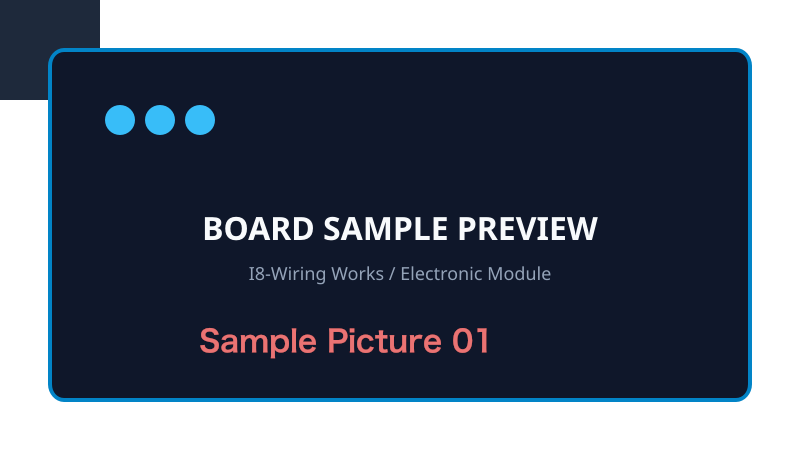

## 概要
ブレッドボードやユニバーサル基板でのプロトタイピングを快適にする、狭ピッチモジュール向けのピッチ変換アダプタ基板です。

## 特徴
- 1.27mmピッチ端子を一般的な2.54mmピッチへ変換
- 高品質FR-4基板、無電解金メッキ（ENIG）表面処理
- ピンアサインをシルク印刷で鮮明に明記

## 仕様
| 項目 | 仕様 |
| :--- | :--- |
| 外形寸法 | 25.4mm x 18.0mm |
| 基板層数 | 2層 (FR-4) |
| 板厚 | 1.6mm |
| 表面処理 | ENIG (無電解金メッキ) |

## ダウンロード
- 回路図および取扱説明書: [manual.pdf](manual.pdf)
