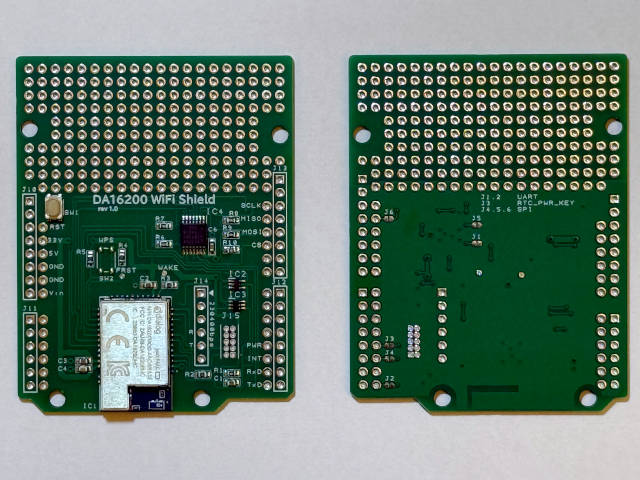
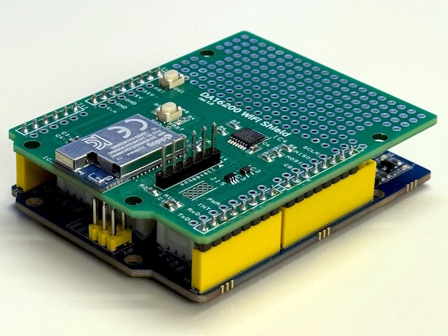
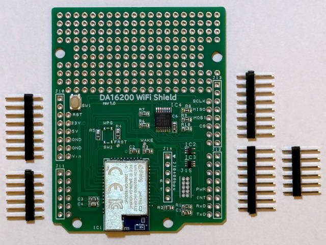

## 概要

バッテリー駆動も可能な超低消費電力WiFiシールドです。
ルネサス DA16200を採用し、5V, 3.3V 両電圧に対応、TCP/IPスタック内蔵により簡単なATコマンドで動作し、UARTに加え高速なSPI通信もサポートします。

Arduino UNO 互換機 (Seeeduino Lotus)に取り付けたところ

## 特徴

* Arduino UNO シールドピン互換の WiFi ボード
* ルネサス DA16200 を使用し、バッテリーでも実用可能な超低消費電力
* TCP/IPスタックを内蔵し、簡単なATコマンドで通信が可能
* 5V, 3.3V 両対応
* マイコンとの接続は、UARTに加えて、より高速なSPIをサポート
* SPI 利用時、本ボードからの送信要求は割り込みに加えてポーリングでも可能
* 簡単な回路を追加することができる、ユニバーサル基板部付き

## 仕様

| 項目 | 仕様 | 備考 |
| :--- | :--- | :-- |
| 利用モジュール | Renesas DA16200 | [https://www.renesas.com/ja/products/da16200](https://www.renesas.com/ja/products/da16200)
| 外形寸法 | 53mm x 68mm |  |
| 電源 | 3.3 〜 5V  |  |
| マイコンとの接続 | UART もしくは SPI | ソルダージャンパーおよびファームウェアによる排他使用 出荷時はUART設定 |

## 取り付けについて

標準的なヘッダピンを同梱しますが、ハンダ付けはされていません。

これは、ユースケースによって細ピンやソケット、ロングピンなど最適な形状が異なるためです。

## デモンストレーション（ATコマンド）

## 技術資料

* [動作確認](check)
* [回路図](schema)
* [サンプルコード](samples)
* [SPI利用方法（ファームウェア書き込み）](use_spi)
