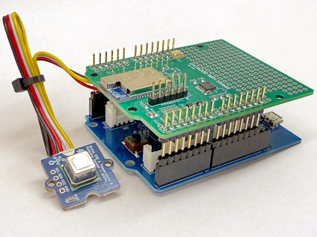

## サンプルコード RBoard UART

### 準備

付属のヘッダピンなどを使い、RBoardへ接続してください。

以下の例は、ロングピンを使い、grove コネクタへの接続を邪魔しないようにした場合です。



### プログラム：APへの接続

APへの接続情報を、DA16200へ設定するサンプルです。
APへの接続は、[アクセスポイントへの接続](../connect_ap)ページ の方法でも可能ですが、このプログラムでも可能です。

#### ファイル

* [メインコード](files/init_module.rb)
* [ライブラリ](files/da16200.rb)

__メインコード参考表示__

```ruby
#
# WiFiモジュールの初期化、APを指定して接続開始
#
# * 購入後、一度だけ実行します（次回起動時は、この工程はスキップできます）
# * 設定は、WiFIモジュール内に保存されます。
#

SSID = "SSID"
PASS = "password"

sleep 3
puts "Program START"

$wifi = DA16200.new(UART.new(baudrate:115200))

#
# 初期化とAPへの接続
#
$wifi.debug_print = true
$wifi.initial_setup()
$wifi.connect_ap( SSID, PASS )
puts "Connected SSID: #{$wifi.connected_ssid}"
$wifi.set_sntp()
$wifi.debug_print = false

while true
  puts "="*40
  sleep 10

  $wifi.stat.each {|k,v|
    puts "#{k}: #{v}"
  }
end
```

#### 使用方法

* 上記2つのファイルをダウンロードします。
* `init_module.rb` の先頭にある SSIDとPASSを接続するAPの設定に書き換えます。
* [RBoard利用方法](https://yoshihiroogura.github.io/RBoardDocument/write_program.html) の手順に従って、ターゲットに書き込みます。
* 実行が始まると、モジュールへ設定を行った後、接続状態を 10秒ごとに表示しますので、正しく接続できたか確認します。

**正常に接続できた場合の出力例**
```
========================================
mac_address: d4:3d:39:00:00:00
bssid: 00:1a:eb:00:00:00
ssid: SSID
id: 0
mode: STATION
key_mgmt: WPA2-PSK
pairwise_cipher: CCMP
group_cipher: CCMP
channel: 6
wpa_state: COMPLETED
ipv4: 192.168.1.3
ipv4_mask: 255.255.255.0
ipv4_gw: 192.168.1.1
dns: 192.168.1.1
all_ok: true
========================================
```


-----
### プログラム：HTTP GET, POST サンプル

* https://httpbin.org へ、HTTP GET プロトコルでアクセスします。
* その際、パラメータとして param1=111 param2=222 を送信します。
* サイトからのレスポンスを、コンソール表示します。
* 引き続き、POSTプロトコルでアクセスします。
* その際、パラメータとして、JSONフォーマットデータを送信します。
* サイトからのレスポンスを、コンソール表示して終了します。

#### ファイルダウンロード

* [メインコード](files/http_get_post.rb)
* [ライブラリ](files/da16200.rb)

__メインコード参考表示__

```ruby
#!/usr/bin/env ruby
#
# HTTP GET および POST のサンプル
#
# * WiFi AP に接続が完了していること。
#

sleep 3
puts "Program START"

$wifi = DA16200.new(UART.new(baudrate:115200))
#$wifi.debug_print = true

# Waiting for AP connection.
$wifi.sync()
while !$wifi.stat["all_ok"]
  puts "Waiting for AP connection."
  $wifi.reconnect_ap()
  sleep 10
end


#
# HTTP GET test
#
# param=value 形式のデータを付加してGETプロトコルでアクセスするサンプル
#
puts "========== HTTP GET TEST =========="

url = "https://httpbin.org/get"
param = "param1=111&param2=222"
res = $wifi.http_get(url + "?" + param)

res.each {|k,v|
  puts "\n==== #{k} ===="
  puts v
}

# 連続してDA16200にアクセスを依頼すると、モジュール内部でのクリーンアップ処理が
# 追いつかない場合があるので、ウェイトをかける。
sleep 1

#
# HTTP POST test
#
# JSONデータのPOST
#
puts "\n\n========== HTTP POST TEST =========="

url = "https://httpbin.org/post"
postdata = '{"key1":"ABCD", "key2":1234}'
res = $wifi.http_post( url, postdata,
                       http_headers:{"Content-Type"=>"application/json"} )
res.each {|k,v|
  puts "\n==== #{k} ===="
  puts v
}
```

#### 使用方法

* DA16200を、アクセスポイントへ接続した状態にします。
* 上記2つのファイルをダウンロードします。
* [RBoard利用方法](https://yoshihiroogura.github.io/RBoardDocument/write_program.html) の手順に従って、ターゲットに書き込みます。

__実行例__

```
Program START
========== HTTP GET TEST ==========

==== cmd_status ====
0

==== http_status ====
200

==== headers ====
{"access-control-allow-credentials"=>"true", "access-control-allow-origin"=>"*", "access-control-expose-headers"=>"Retry-After, RateLimit, RateLimit-Policy, WWW-Authenticate", "content-length"=>"309", "content-type"=>"application/json", "x-content-type-options"=>"nosniff", "date"=>"Sat, 14 Nov 2026 05", "connection"=>"close"}

==== body ====
{
  "args": {
    "param1": "111",
    "param2": "222"
  },
  "headers": {
    "Accept": "*/*",
    "Host": "httpbin.org",
    "User-Agent": "lwIP/2.1.2 (http://savannah.nongnu.org/projects/lwip)"
  },
  "method": "GET",
  "origin": "xxx.xxx.xxx.xxx",
  "url": "https://httpbin.org/get?param1=111&param2=222"
}


========== HTTP POST TEST ==========

==== cmd_status ====
0

==== http_status ====
200

==== headers ====
{"access-control-allow-credentials"=>"true", "access-control-allow-origin"=>"*", "access-control-expose-headers"=>"Retry-After, RateLimit, RateLimit-Policy, WWW-Authenticate", "content-length"=>"348", "content-type"=>"application/json", "x-content-type-options"=>"nosniff", "date"=>"Sat, 14 Nov 2026 05", "connection"=>"close"}

==== body ====
{
  "args": {},
  "headers": {
    "Content-Length": "28",
    "Content-Type": "application/json",
    "Host": "httpbin.org"
  },
  "method": "POST",
  "origin": "xxx.xxx.xxx.xxx",
  "url": "https://httpbin.org/post",
  "data": "{\"key1\":\"ABCD\", \"key2\":1234}",
  "files": {},
  "form": {},
  "json": {
    "key1": "ABCD",
    "key2": 1234
  }
}
```
