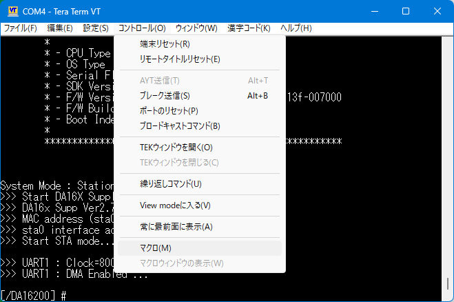
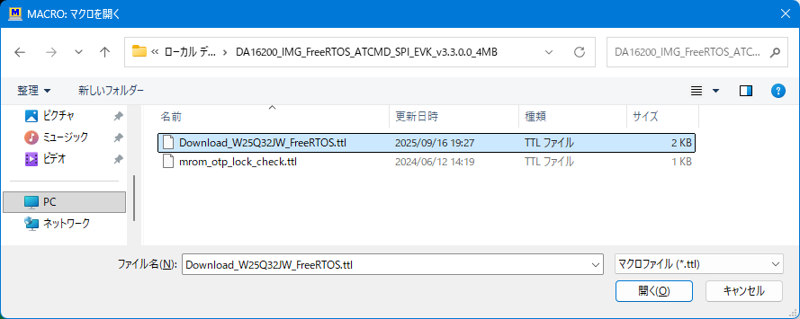
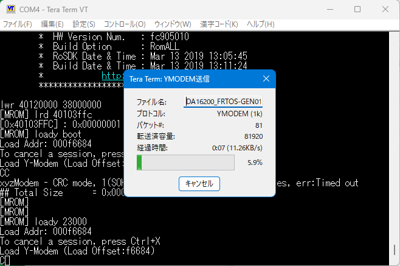
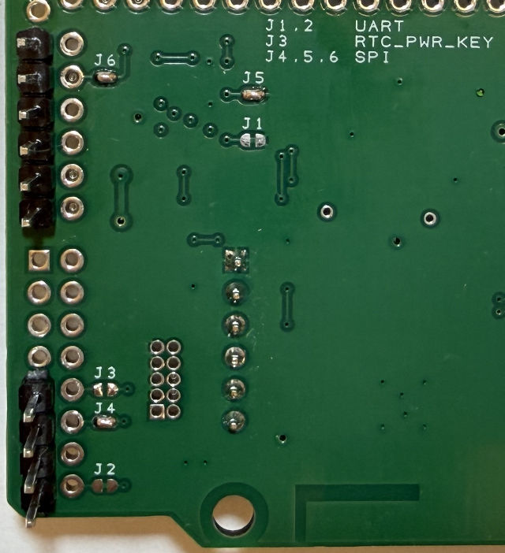

## SPIの利用方法

SPIを使うには、DA16200 モジュール内のファームウェアを SPI用に書き換える必要があります。
いくつか方法がありますが、ここでは [TeraTerm](https://teratermproject.github.io/) を利用する方法を紹介します。

### ファームウェア入手

1. ルネサス DA16200 ページの [ソフトウェア／ツール](https://www.renesas.com/en/products/da16200?tab=software-tools) ページから、__DA16200 DA16600 FreeRTOS SDK Image__ をダウンロードします。
2. zipを展開すると、さらに7つのzipファイルに展開されます（2026/10 現在 v3.3.0.0 の場合）

### ファームウェア書き込み

対象のファイルは、
　__DA16200_IMG_FreeRTOS_ATCMD_SPI_EVK_v3.3.0.0_4MB.zip__
です。

DA16200用とDA16600用がありますので、間違えないようにしてください。

1. ファイル「DA16200_IMG_FreeRTOS_ATCMD_SPI_EVK_v3.3.0.0_4MB.zip」を展開します。
2. [動作確認ページのボード単体で確認する場合](../check) を参考に、ターミナルソフト teraterm を接続して起動します。
3. 一度 `[Enter]` を押して、`[/DA16200] #` と表示されることを確認します。
4. メニューバーから、`コントロール > マクロ` と選択します。
    

5. ファイルを選ぶダイアログが開くので、**Download_** で始まるファイルの方を選びます。
    

6. 自動的に書き込みが始まり、下記ダイアログが2回表示されます。
    

7. 下記画像を参考に、J4,J5,J6 ハンダジャンパーをブリッジさせます。
また、UARTを完全に使わない場合など、必要に応じて J1,J2 をパターンカットします。
    

以上で終了です。

----------------------------------------
### UARTに戻す

UARTモードに戻すには、
　__DA16200_IMG_FreeRTOS_ATCMD_UART1_EVK_***.zip__
を展開し、同様の手順で書き込みます。

また、J1,J2 ジャンパーをカットした場合は、ハンダブリッジでもとに戻します。
